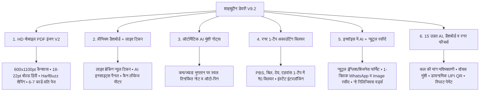

# 🥛 शाहबुद्दीन डेयरी (Shahbuddin Dairy) V9.2 — अंतिम स्वीकृत मास्टर प्लान

> [!IMPORTANT]
> **प्रमुख तकनीकी प्राथमिकताएं**:
> 1. **PDF हिंदी फॉन्ट फिक्स (HarfBuzz & High-DPI Shaping)**: 380pt के बजाय `600 x 1100 pt` कैनवास, `18pt–22pt` बोल्ड टाइपोग्राफी, और देवनागरी लिपि के लिए `TextPaint` + `Typeface.create(Typeface.SANS_SERIF, Typeface.BOLD)` ताकि मात्राएं (इ, ी, ु, ू, आधा र्, संयुक्त अक्षर) बिल्कुल साफ़, बड़े और बिना ज़ूम किए दिखें।
> 2. **ईमेल पूर्णतः निरस्त**: केवल **WhatsApp डायरेक्ट शेयर**, **720px इमेज रसीद (PNG)** और **HD मोबाइल PDF रिपोर्ट**।
> 3. **न्यूट्रल प्रोफेशनल रसीद व संदेश**: किसी भी प्रकार का धार्मिक अभिवादन (नमस्ते, अस्सलाम वालेकुम, या 🙏 इमोजी) नहीं होगा। केवल आधिकारिक नाम **"Shahbuddin Dairy"**, प्रोपराइटर विवरण, तारीख, दूध मात्रा, दर, कुल बिल, जमा राशि और बकाया शेष।
> 4. **डैशबोर्ड और रनर यूआई**: आधुनिक मटेरियल 3 डिज़ाइन, लाइव ब्रेकिंग न्यूज़ टिकर, और रनर कार्ड पर 1-टैप अकाउंटिंग क्लियर।

---

## 📑 संपूर्ण 20+ फीचर्स का आर्किटेक्चर



---

### 1. हाई-डेफिनिशन मोबाइल PDF इंजन V2 (Zero-Zoom & Hindi Font Fix)
- **कैनवास साइज़**: `600 x 1100 pt` (Realme C55 के 20:9 आस्पेक्ट रेशियो के अनुसार फुल स्क्रीन फिट)।
- **हिंदी फॉन्ट फिक्स**: 
  - `TextPaint` का उपयोग, `isAntiAlias = true`, `isSubpixelText = true`, `typeface = Typeface.create(Typeface.SANS_SERIF, Typeface.BOLD)`.
  - हिंदी मात्राओं (जैसे 'पड़ोसी', 'बिहारीपुर', 'कन्हैया') की संयुक्त बनावट (Conjuncts) बिना टूटे 100% सटीक और स्पष्ट रेंडर होगी।
- **बड़ा और बोल्ड कार्ड लेआउट**:
  - प्रति पेज केवल 6 से 7 बड़े कार्ड्स (कार्ड ऊंचाई: 85pt)।
  - **ग्राहक का पूरा नाम**: 19pt बोल्ड।
  - **दूध व दर विवरण**: 14pt (मात्रा, भैंस/गाय, दर, आज का बिल, पुराना PBS)।
  - **बोल्ड पन्ना हरा नकद बॉक्स**: `💰 नकद जमा: ₹...` (16pt बोल्ड सफेद टेक्स्ट हरे बैकग्राउंड पर)।
  - **बकाया व एडवांस पिल**: `🔴 कुल बकाया: ₹...` या `🟢 कुल एडवांस: ₹...` (16pt बोल्ड)।
- **पेज 1**: मुख्य ब्रांड हेडर + 4 बड़े KPI कार्ड्स + 4 स्टेटस पिल्स + पहले 6 ग्राहक कार्ड्स।
- **अंतिम पेज**: संपूर्ण वित्तीय हिसाब मिलान, वसूली रसीदें, शीर्ष खाते, और आधिकारिक डिजिटल मुहर।

---

### 2. प्रीमियम डैशबोर्ड एवं लाइव ब्रेकिंग न्यूज़ टिकर
- **लाइव ब्रेकिंग न्यूज़ टिकर (Live News Marquee)**:
  - हेडर के ठीक नीचे एक एनिमेटेड क्षैतिज टिकर चलेगा जो वास्तविक समय में डेयरी के प्रमुख समाचार दिखाएगा:
    - 📢 `🚨 PAYMENT ALERT: Kanhiya Ji ₹4,512 due • Dilip Uncle ₹1,890 due`
    - 🥛 `SUPPLY UPDATE: 47.05 L delivered today (40 served, 7 naaga)`
    - 💰 `COLLECTION UPDATE: ₹1,510 cash & online received today`
    - 🔵 `ALTERNATE REMINDER: 3 customers on alternate off schedule today`
- **AI बिज़नेस इनसाइट्स पैनल**:
  - शीर्ष 3 बकायादार (1-टैप त्वरित WhatsApp तकादा बटन सहित)।
  - शीर्ष 3 अग्रिम जमा ग्राहक।
  - आज का सबसे बड़ा भुगतान।
  - AI मुंशी की व्यावहारिक सलाह (Reminders & Tips)।
- **कैन/गाड़ी लाइव दूध संतुलन एवं लीकेज मीटर**:
  - लोड दूध (50L) बनाम बिका दूध (47.05L) बनाम कैन में बचा दूध (2.95L)।
- **दैनिक अनुमानित लाभ एवं मार्जिन मीटर**:
  - आज की कुल बिक्री में से खरीद लागत घटाकर आज का शुद्ध मुनाफा (`+₹...`)।
- **क्विक-एक्शन स्पीड डायल बार**: 1-टैप में नया ग्राहक जोड़ना, त्योहार पर बल्क अवकाश, और तुरंत बैकअप डाउनलोड।
- **ग्राहक स्वास्थ्य हीटमैप**: नियमित (हरे), अनियमित (पीले), और छोड़ने वाले (लाल) का वर्गीकरण।
- **मासिक बिलिंग 1-क्लिक क्लोजर**: माह के अंत में सभी 50 ग्राहकों का मासिक बिल 1 क्लिक में तैयार करना।

---

### 3. ऑटोमैटिक स्मार्ट AI नोट्स इंजन (ऑटो-पिनिंग सिस्टम)
- जब रनर दूध दर्ज करके `[✓ SAVED ✓]` दबाएगा:
  - यदि भुगतान कम है (उदा० बिल ₹120, नकद ₹100):
    - AI तुरंत नोट लिखेगा: `💰 भुगतान शेष (दिनांक: 29 Oct 2026): दूध बिल ₹120 में से ₹100 प्राप्त हुआ। शेष ₹20 कल के लिए बाकी रह गए।`
    - **`isPinned = true`** — अगले दिन जब रनर उस ग्राहक पर पहुंचेगा, तो पीले पिन-बॉक्स में यह नोट सबसे ऊपर दिखेगा।
  - यदि भुगतान अधिक है (उदा० बिल ₹100, नकद ₹200):
    - AI नोट लिखेगा: `🟢 अग्रिम जमा: अतिरिक्त ₹100 खाते में एडवांस जमा किए गए।`
    - **`isPinned = true`**
- यह नोट `NotesScreen` में भी तारीख और ग्राहक के नाम के साथ सहेजा जाएगा।

---

### 4. रनर अकाउंटिंग ग्रिड 1-टैप क्लियर एवं रियल-टाइम इंटरलॉकिंग
- रनर कार्ड पर 4 अकाउंटिंग बॉक्स:
  - **बॉक्स 1**: आज बिल (Today Bill)
  - **बॉक्स 2**: पुराना PBS (Previous PBS)
  - **बॉक्स 3**: कुल देय (Total Due)
  - **बॉक्स 4**: एडवांस (Advance)
- किसी भी बॉक्स पर टैप करने पर तुरंत 1-टैप **`[ 🗑️ क्लियर करें (₹0) ]`** बटन।
- कोई गैर-ज़रूरी कन्फर्मेशन नहीं — 1 टैप में राशि 0 और बाकी तीनों बॉक्स, कुल बैलेंस, और नकद चिप्स उसी मिलीसेकंड में नए हिसाब से इंटरलॉक।

---

### 5. इनवॉइस में AI एवं न्यूट्रल रसीदें (Neutral Professional Invoicing)
- **ईमेल पूर्णतः हटा दिया गया है** — केवल **1-Click WhatsApp Direct** और **1-Click Image Receipt (PNG)**।
- **धार्मिक शब्दों पर पूर्ण रोक**: किसी भी प्रकार का "नमस्ते", "अस्सलाम वालेकुम", या "🙏" इमोजी नहीं होगा।
- **आधिकारिक न्यूट्रल प्रारूप**:
  ```text
  🥛 SHAHBUDDIN DAIRY
  Bareilly, Uttar Pradesh • Phone: 9258263340
  ────────────────────────────────────
  Date: 29 Oct 2026 | Time: 06:30 PM
  Customer: Bhola Nath (ID: #1)
  Milk Delivered: 2.5 L (Buffalo) @ ₹70/L
  Today's Bill: ₹175.00
  Cash Paid: ₹175.00
  ────────────────────────────────────
  Previous Balance (PBS): ₹1,505.00
  Net Remaining Due: ₹1,505.00
  ────────────────────────────────────
  💡 AI Insight: Regular daily delivery • 100% on-time payment track record.
  Thank you for choosing Shahbuddin Dairy.
  ```
- **इमेज रसीद**: 720px हाई-क्वालिटी PNG रसीद (डायनामिक UPI QR कोड के साथ), जिसे 1 टैप में WhatsApp पर भेजा जा सकता है।

---

### 6. शामिल किए जा रहे अन्य उन्नत फीचर्स
1. **कल के दूध की AI मांग भविष्यवाणी**: कल सुबह गाड़ी में कितना दूध लोड करना है इसका पूर्व-अनुमान।
2. **हैंड्स-फ्री लोकल वॉयस मुंशी**: माइक पर बोलकर दूध और पैसे दर्ज करना।
3. **AI डिफ़ॉल्ट रिस्क डिटेक्टर**: 10 दिन से पेमेंट न करने वाले और ₹2,000+ उधारी वाले ग्राहकों पर लाल चेतावनी।
4. **ग्राहक आदत और सैलरी प्रोफाइल**: ग्राहक की भुगतान तारीख याद रखना।
5. **डायनामिक ग्राहक यूपीआई क्यूआर कोड**: ग्राहक के ठीक उस समय के बकाया/बिल का PhonePe/GooglePay QR कोड स्क्रीन पर दिखाना।
6. **नकद + ऑनलाइन स्प्लिट पेमेंट चिप**: एक ही टैप में *"₹100 नकद + ₹150 ऑनलाइन"* दर्ज करना।
7. **गली व रास्ते के अनुसार स्मार्ट रूट क्रम**: गली मनिहारान -> मंदिर -> कटरा -> शास्त्री मार्केट के अनुसार रूट सॉर्टिंग।
8. **सुखद ऑडियो वॉयस फीडबैक**: दूध सेव होते ही स्क्रीन देखे बिना हिंदी में वॉयस पुष्टि: *"✓ 2.5 लीटर भैंस दर्ज, ₹175 जमा"*.
9. **रास्ते में तुरंत नया वॉक-इन ग्राहक जोड़ना**: रूट पर किसी नए व्यक्ति के दूध मांगने पर 10 सेकंड में त्वरित एंट्री।

---

### 🛡️ सुरक्षा, टेस्टिंग एवं रिलीज़
- आपके सभी **53 ग्राहक**, **1,770 डिलीवरी रिकॉर्ड्स** और खाताबही 100% सुरक्षित रहेंगी।
- ऐप को वर्ज़न कोड 21, **वर्ज़न नेम 9.2 (`v9.2.0`)** के रूप में कंपाइल किया जाएगा।
- वायरलेस डिबगिंग से आपके फोन (`Realme C55 / RMX3710`) पर सीधे इंस्टॉल व लाइव स्क्रीनशॉट से सत्यापन होगा।
- गिटहब पर कमिट, टैग `v9.2.0` और स्वचालित रिलीज़ पब्लिश होगी।
